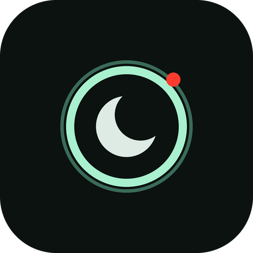

<p align="center">
  
</p>

<h1 align="center">NVCam</h1>

<p align="center">A camcorder night-shot camera for Android. Your camera, run through the look of an old handycam filming in the dark, baked into every photo and video.</p>

<p align="center">
  
</p>

---

NVCam runs the live camera feed through a GLSL fragment shader that fakes a camcorder
night-shot frame: almost monochrome, near-black shadows with a faint purple, neutral mids
and mint-white highlights that glow. Detail is soft, there is a little grain and a slight
lens bulge. It stays subtle on purpose: no tube edge, no scanlines, no reticle. Photos and
video are saved with the look baked into the pixels.

NVCam grew out of [CCDCam](https://github.com/sturq/ccdcam) and shares its camera and
recording pipeline, with its own shader, HUD and icon.

## Features

- **Live filtered preview** at full display refresh rate
- **Photo mode**: JPEG snapshot of the filtered frame, saved to `Pictures/NVCam/` (preview resolution for now)
- **Video mode**: H.264 MP4 plus AAC audio with the look baked in, saved to `Movies/NVCam/`
- **Pinch-to-zoom** clamped to the lens's min/max
- **Night HUD**: mint-on-black corner brackets, `HH:MM:SS:FF` timecode, `STBY`/`REC` with a blinking red dot, `☾ NIGHT` label, battery icon, live date stamp
- **Front/back camera flip**, 16:9 or 4:3
- **Material You adaptive icon** with a monochrome layer for themed icons on Android 13+
- **Python sim** (`tools/nv_sim.py`): a numpy copy of the shader, so the look can be tuned on a JPEG without rebuilding the APK
- **Debug control**: debug builds take commands over `am start`, so the app can be tested from a script

## What the shader does

`app/src/main/assets/shaders/nv.frag`, in order:

1. Slight barrel bulge, circular on screen, corners stay in place
2. 3x3 gaussian blur with taps under 2 px apart, so edges go soft instead of doubling
3. Halo: bright areas bleed a small glow into their surroundings
4. Exposure push and a curve that keeps the darks dark
5. Grain in 2x2 pixel cells, new every frame
6. Black floor around 12/255, as in the reference frame
7. Split tone: faint purple in the shadows, mint in the highlights, both luma-neutral
8. The brightest parts bleach toward white
9. Radial vignette

The tones were measured from a real night-shot frame: the darkest 2 % sit at RGB (15, 10, 16),
the 90th percentile at (203, 221, 209). All constants live at the top of the file.

## Architecture

- **CameraX 1.4** binds `Preview` and `VideoCapture` in one `UseCaseGroup` with a `CameraEffect` (`NvEffect`)
- **`NvSurfaceProcessor`** owns one EGL context and the camera `SurfaceTexture`, and draws every frame through `nv.frag` into each output (preview and video encoder) with the transform CameraX supplies, so rotation stays native
- Pixel offsets in the shader go through `dFdx`/`dFdy` of the texture coordinate, because the camera texture can be rotated against the output
- **Photo capture** takes `PreviewView.bitmap`, rotates it upright and writes a JPEG via `MediaStore`

## Tweaking the look

Edit the constants at the top of `nv.frag` and mirror them in `tools/nv_sim.py` (kept in sync
by hand). Then:

```
python tools/nv_sim.py input.jpg output.jpg
python tools/test_nv_sim.py     # mint highlights, low saturation, dark blacks, halo, determinism
```

## Build

The repo has no Gradle wrapper script; use Gradle 8.7 or newer:

```
gradle assembleDebug     # debug APK
gradle assembleRelease   # release APK, signed with the bundled debug keystore
```

Requires Android 7.0 (API 24) or newer. CI builds on every push to `main`.

## Debug control

Debug builds accept commands while the app is open and log results under the tag `NVCam`:

```
adb shell am start -n at.sturq.nvcam/.MainActivity --es action photo   # or video, flip
adb logcat -s NVCam
```

## License

[GPL-3.0-only](LICENSE)
